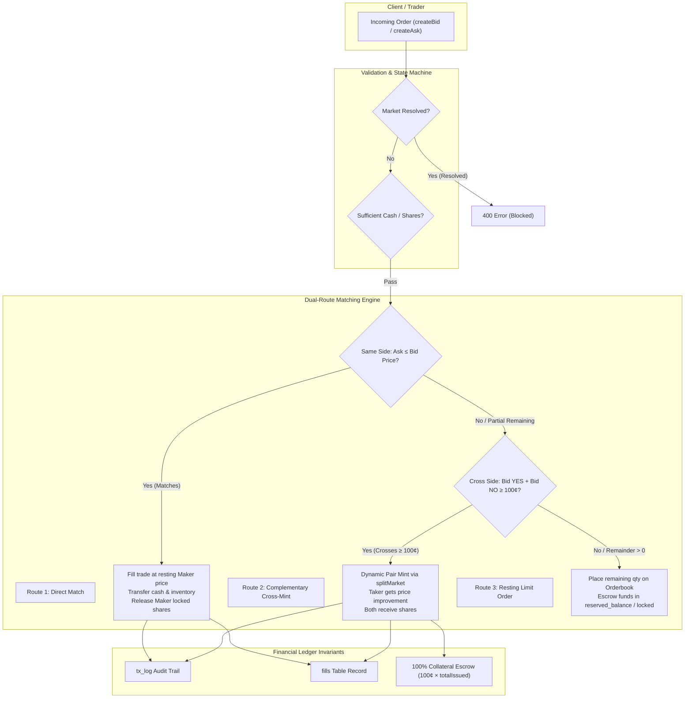

# Kalshi Prediction Market Engine & Settlement Ledger

A high-performance prediction market demonstration project built with **Bun**, **TypeScript**, **Express**, **Prisma ORM**, and **PostgreSQL**. 

Unlike standard CRUD projects, this backend models a real financial exchange: continuous double-auction limit order matching, dynamic cross-book minting, a two-tier escrow state machine, and a guaranteed collateral invariant ($1.00 \equiv 1\text{ YES} + 1\text{ NO}$).

---

## Architecture Overview



---

## Core Engineering Highlights

### 1. Hard Collateral Invariant ($1.00 = 1\text{ YES} + 1\text{ NO}$)
In prediction markets, contracts pay out $1.00 (100¢) to the winning side and $0.00 to the losing side.
- **Minting (`POST /split/:id`):** Users deposit 100¢ cash to mint 1 YES + 1 NO share. Total cash escrow in the market equals exactly $\text{totalIssued} \times 100¢$.
- **Burning (`POST /merge/:id`):** Users surrender 1 YES + 1 NO share to withdraw 100¢ cash, contracting the circulating supply.
- **Invariant Guarantee:** No shares can be created or destroyed without a matching 100¢ cash change in the collateral pool.

### 2. Dual-Route Order Matching Engine
When an aggressive order (taker) enters the engine:
- **Route 1 (Direct Match):** Searches the same side orderbook for resting limit orders (FIFO price-time priority). Trades execute at the **resting maker's price**.
- **Route 2 (Cross-Book Complementary Minting):** If opposing buyers cross ($\text{Bid}_{\text{YES}} + \text{Bid}_{\text{NO}} \ge 100¢$), the engine dynamically mints a new YES/NO pair from market collateral. The resting maker gets their limit price, and the incoming taker receives **price improvement** ($100¢ - \text{makerPrice}$).
- **Route 3 (Resting Order Escrow):** Any unfilled quantity rests on the book as a limit order with full balance escrow.

### 3. Two-Tier Escrow State Machine
To guarantee zero double-spending under concurrent requests:
- **Cash Balances:** Separated into `available_balance` (spendable) and `reserved_balance` (escrowed for resting bids).
- **Share Balances:** Separated into `qty` (free inventory) and `locked` (escrowed in resting asks).
- **Audit Logging:** Every balance movement (deposit, split, fill, merge, win) writes an immutable record to `tx_log`.

### 4. Market Resolution & Settlement (`POST /market/resolve/:id`)
- Admin-verified resolution marks the market outcome (`YES` or `NO`).
- Unfilled resting bids and asks are automatically cancelled and refunded from escrow.
- Winning shareholders are paid 100¢ cash per share into their `available_balance`.
- Resolved markets are permanently locked against subsequent orders or state changes.

---

## API Specification

### Authentication & Wallet
| Method | Endpoint | Description |
| :--- | :--- | :--- |
| `POST` | `/api/v1/signup` | Register a new user |
| `POST` | `/api/v1/signin` | Authenticate and obtain JWT token |
| `POST` | `/api/v1/onramp` | Top up cash balance (+50¢ per call) |
| `GET` | `/api/v1/balance` | Get user available & reserved balance |

### Market Operations & Ledger
| Method | Endpoint | Description |
| :--- | :--- | :--- |
| `POST` | `/api/v1/market` | Create a new prediction market |
| `GET` | `/api/v1/market` | List all active, unresolved markets |
| `POST` | `/api/v1/split/:marketId` | Mint complete YES + NO pairs from cash |
| `POST` | `/api/v1/merge/:marketId` | Burn complete YES + NO pairs for cash |
| `POST` | `/api/v1/market/resolve/:id` | Resolve market and payout winning shares (Admin only) |

### Order Engine & Portfolio
| Method | Endpoint | Description |
| :--- | :--- | :--- |
| `POST` | `/api/v1/create/bid/:id` | Place a BUY limit order / match existing liquidity |
| `POST` | `/api/v1/create/ask/:id` | Place a SELL limit order / match existing liquidity |
| `GET` | `/api/v1/portfolio` | Get active user share holdings across markets |
| `GET` | `/api/v1/fills` | Get user executed trade history |
| `GET` | `/api/v1/transaction` | Get complete ledger audit log (`tx_log`) |

> **Note on Authentication:** Protected routes expect the JWT token in the header as:  
> `token: Bearer <jwt_token>`

---

## Startup Guide

### Prerequisites
- [Bun](https://bun.sh/) (v1.1+ installed)
- [PostgreSQL](https://www.postgresql.org/) database (local or hosted on [Neon](https://neon.tech/))

### 1. Clone & Install
```bash
git clone https://github.com/deepankbisht/kalshi.git
cd kalshi
bun install
```

### 2. Configure Environment Variables
Create a `.env` file in the project root:
```env
PORT=4420
DATABASE_URL="postgresql://<user>:<password>@<host>/<database>?sslmode=require"
JWT_URL="your-secure-jwt-secret-key"
SALTROUND=10
```

### 3. Database Migration & Prisma Client
Generate the Prisma client and push the schema to PostgreSQL:
```bash
bunx prisma db push
bunx prisma generate
```

### 4. Start Development Server
```bash
bun run dev
```
The server will start listening at: `http://localhost:4420`

---

## Automated Testing

The project includes an end-to-end integration test suite in [`tests/market.test.ts`](tests/market.test.ts) covering the full lifecycle:
- User signup, signin, and JWT auth
- Wallet onramp and ledger logging
- Market creation and discovery
- Pair minting (`split`) and burning (`merge`)
- Limit order placement, share locking, and execution
- Direct matching and complementary cross-book minting
- Market resolution, order unlocking, and winner payouts
- Post-resolution security guards

Run the test suite:
```bash
bun test tests/market.test.ts
```

```text
bun test v1.4.4
tests/market.test.ts:
✓ 1. Authentication & Wallet Onramp > Alice onramps funds (+50 cents)
✓ 2. Market Lifecycle Creation & Fetching > Admin creates a prediction market
✓ 2. Market Lifecycle Creation & Fetching > GET /market returns active markets
✓ 3. Split Functionality (Minting Pairs) > Mint 20 YES + 20 NO pairs
✓ 4. Direct Order Placement & Matching > Alice places resting Ask
✓ 4. Direct Order Placement & Matching > Bob places Bid (Direct Match)
✓ 5. User Read Queries > GET /balance, /portfolio, /fills, /transaction
✓ 6. Merge Functionality (Burning Pairs) > Burn 5 pairs for cash
✓ 7. Market Resolution & Winner Payout > Admin resolves market & pays winners
✓ 7. Security Guards > Rejects post-resolution orders & duplicate resolution

24 pass
0 fail
118 expect() calls [54.88s]
```

---

## Tech Stack
- **Runtime:** [Bun](https://bun.sh/)
- **Framework:** [Express.js](https://expressjs.com/)
- **Language:** [TypeScript](https://www.typescriptlang.org/)
- **Database & ORM:** [PostgreSQL](https://www.postgresql.org/) / [NeonDB](https://neon.tech/) with [Prisma 7](https://www.prisma.io/)
- **Validation & Crypto:** [Zod](https://zod.dev/), [bcrypt](https://github.com/kelektiv/node.bcrypt.js), [jsonwebtoken](https://github.com/auth0/node-jsonwebtoken)
- **Test Runner:** `bun:test`
